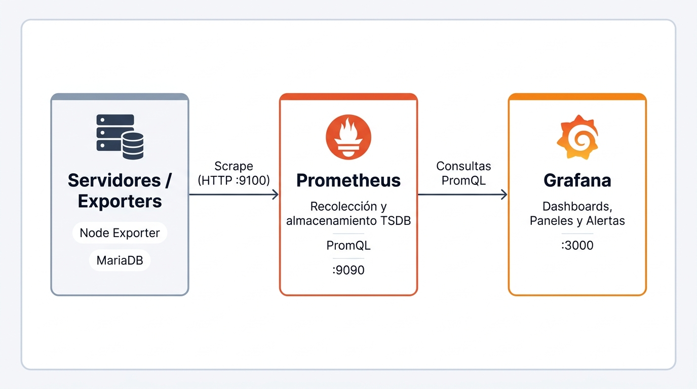

# 0. Introducción a Prometheus y Grafana

**Prometheus** y **Grafana** forman una pareja estándar para la monitorización de sistemas y servicios en tiempo real.

- **Exporters** (`Node Exporter`, etc.): exponen métricas del sistema (CPU, memoria, disco, red) vía HTTP (`:9100`).
- **Prometheus**: recoge (*scrape*) y almacena las métricas como series temporales en su base de datos, permitiendo consultarlas con **PromQL** (`:9090`).
- **Grafana**: se conecta a Prometheus como *Data Source* para crear **dashboards** visuales y configurar **alertas** (`:3000`).
