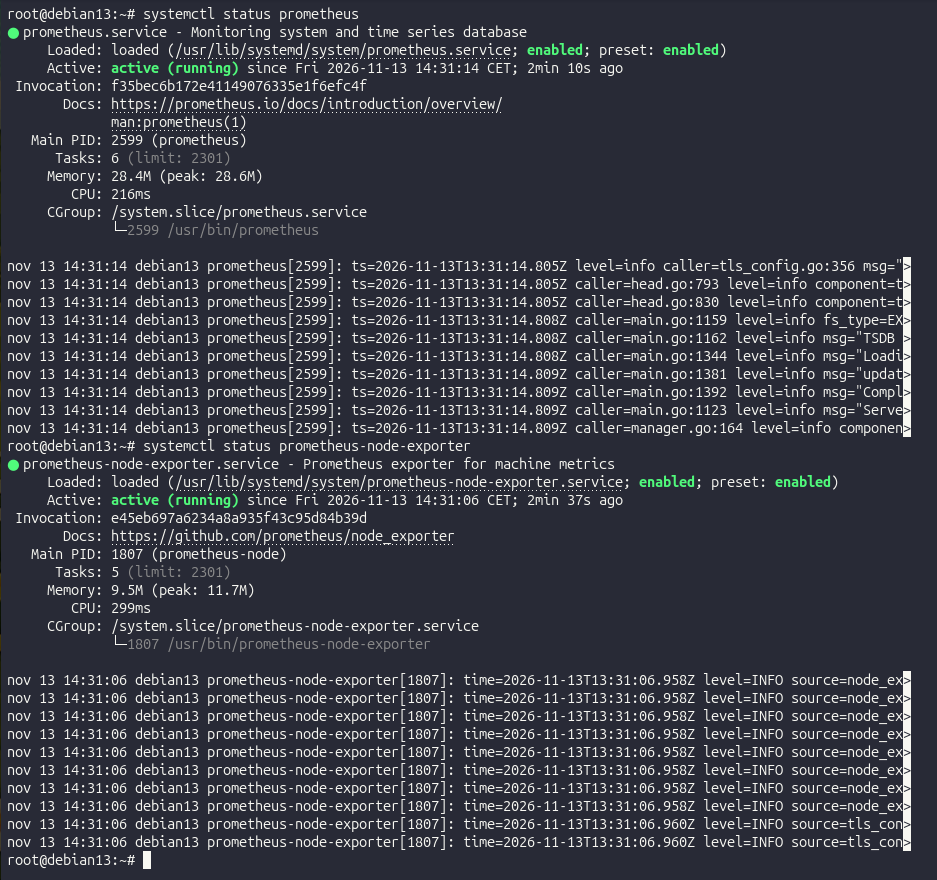

# 1. Instalación de Prometheus

## 1. Estado de los servicios

Comprobamos que `prometheus` y `prometheus-node-exporter` están activos:

## 2. Configuración

Editamos `/etc/prometheus/prometheus.yml` para apuntar al nodo:

## 3. Verificación en el navegador

- **Node Exporter** (`http://172.26.2.64:9100`):

- **Prometheus** (`http://172.26.2.64:9090`):

## 4. Ejemplo de configuración YAML

Configuración en [prometheus-2.yml](/FicherosPrometheus/prometheus-2.yml):

