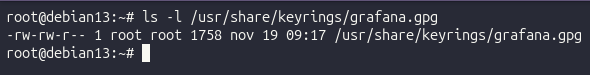
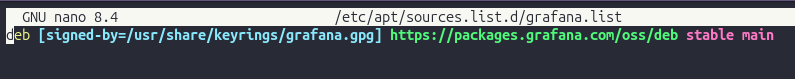
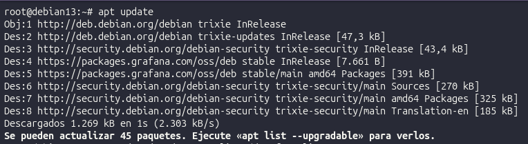
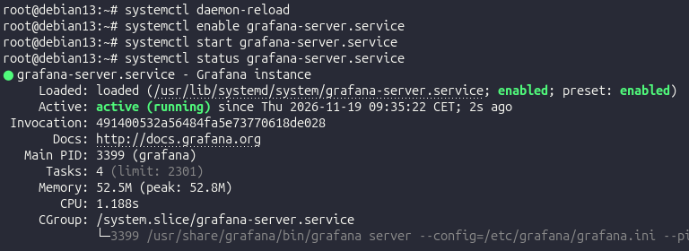
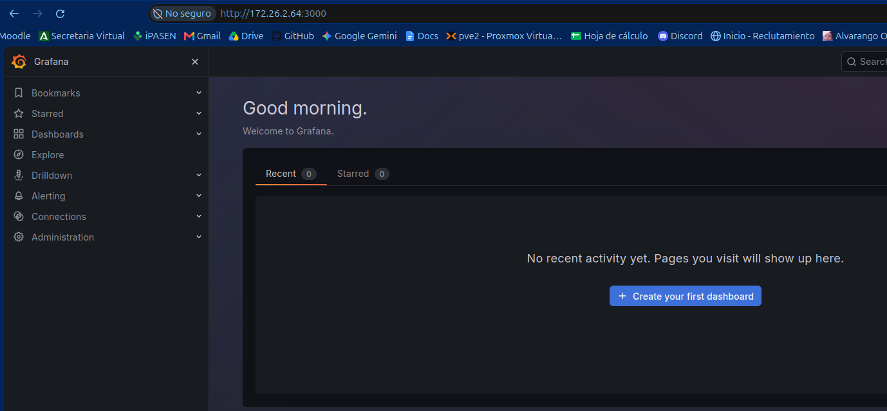

# 2. Instalación de Grafana

## 1. Añadir la clave GPG de Grafana

Descargamos e importamos la clave del repositorio oficial en `/usr/share/keyrings/grafana.gpg`:

Comprobamos que la clave se ha guardado correctamente:

## 2. Añadir el repositorio APT

Creamos `/etc/apt/sources.list.d/grafana.list` con el repositorio oficial:

## 3. Actualizar repositorios

Actualizamos la caché de `apt` para comprobar que carga el repositorio de Grafana:

## 4. Instalar Grafana

Instalamos el paquete `grafana` con `apt`:

## 5. Habilitar y arrancar el servicio

Recargamos `systemd`, habilitamos, iniciamos y comprobamos `grafana-server.service`:

## 6. Verificación en el navegador

Accedemos a la interfaz web de Grafana en `http://172.26.2.64:3000`:

