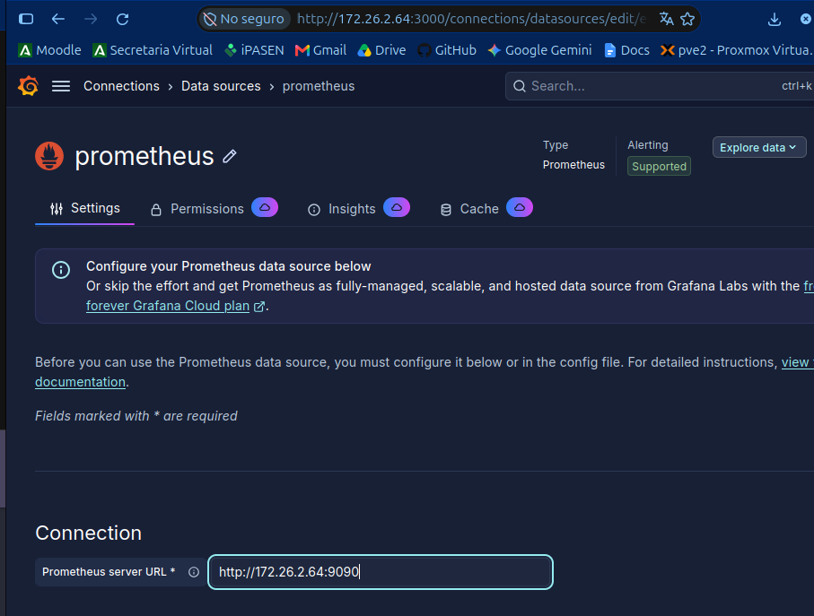
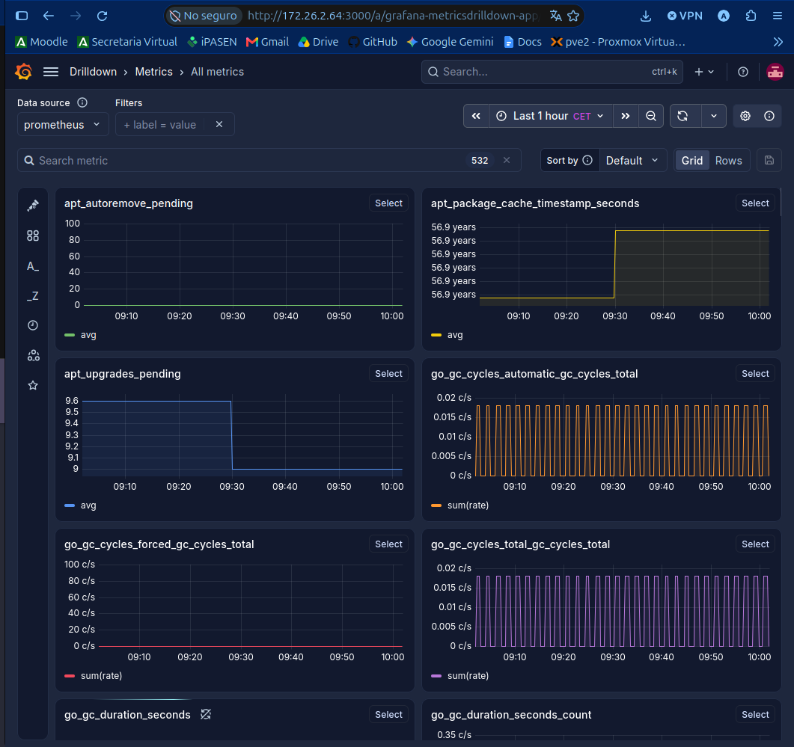
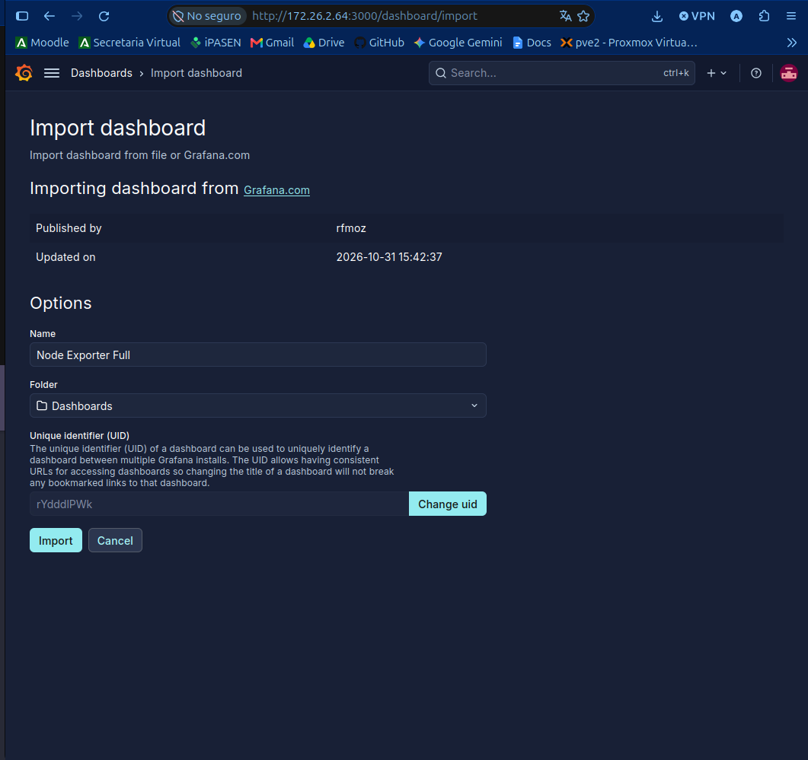
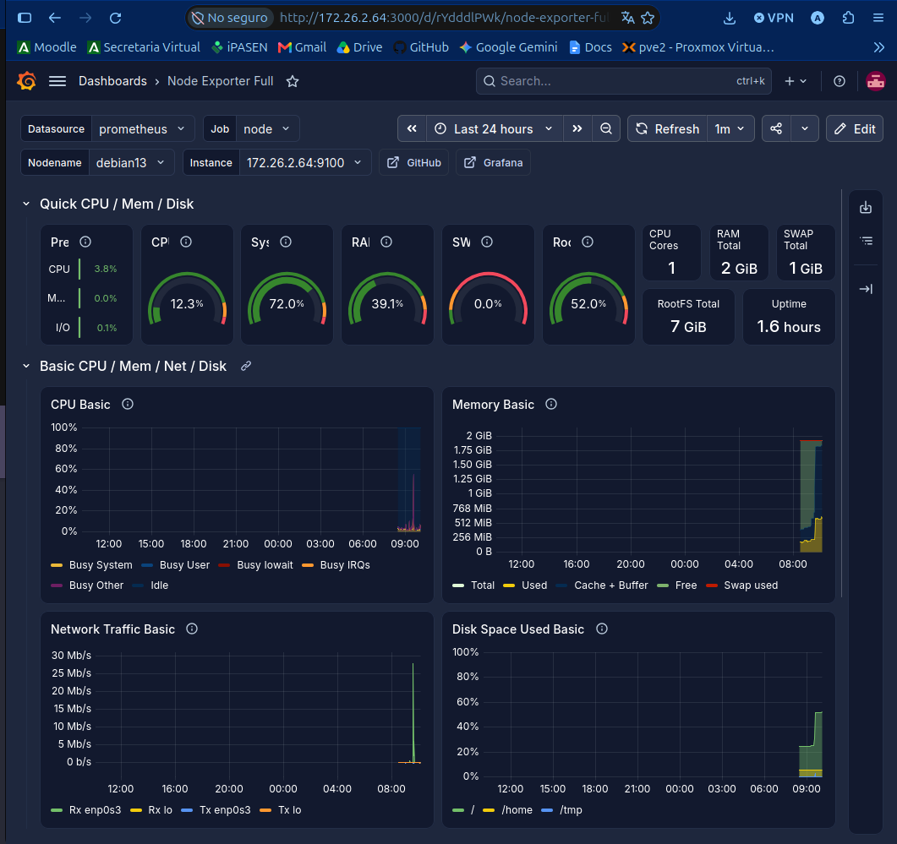

# 3. Añadir Prometheus como Data Source

## 1. Configurar el Data Source

En Grafana vamos a **Connections > Data sources**, añadimos **Prometheus** e indicamos la URL `http://172.26.2.64:9090`:

## 2. Verificar métricas recibidas

Desde **Drilldown > Metrics** comprobamos que Grafana ya recibe y grafica las métricas de Prometheus:

## 3. Importar dashboard *Node Exporter Full*

En **Dashboards > Import dashboard** importamos el dashboard **Node Exporter Full** desde Grafana.com:

Comprobamos el dashboard funcionando con los datos de `debian13` (`172.26.2.64:9100`):

