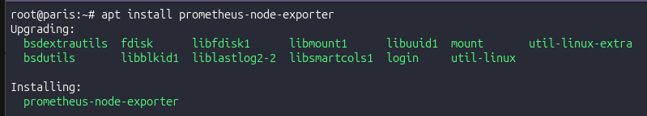
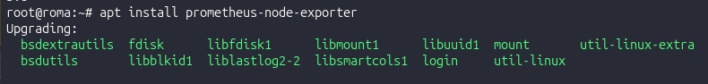
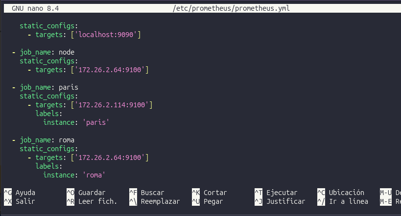
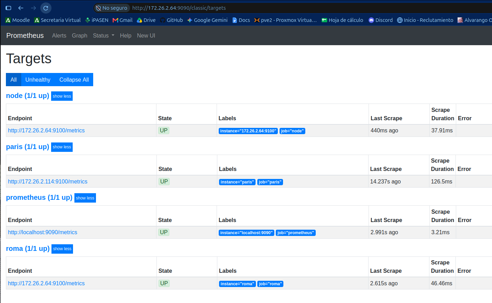

# 4. Monitorización de varios servidores

Para monitorizar varios equipos desde un único servidor Prometheus, instalamos **Node Exporter** en cada nodo y los añadimos como *targets* en `/etc/prometheus/prometheus.yml`:

- **Principal** (Prometheus + Grafana): `172.26.2.64`
- **paris**: `172.26.2.114`
- **roma**: `172.26.2.214`

## 1. Instalación de Node Exporter en los nodos

Instalamos `prometheus-node-exporter` en los contenedores (`paris` y `roma`):

## 2. Configurar los targets en Prometheus

Añadimos los nuevos nodos (`paris` y `roma`) en `/etc/prometheus/prometheus.yml`:

## 3. Verificar targets en Prometheus

Comprobamos en `http://172.26.2.64:9090/classic/targets` que todos los nodos aparecen en estado `UP`:

